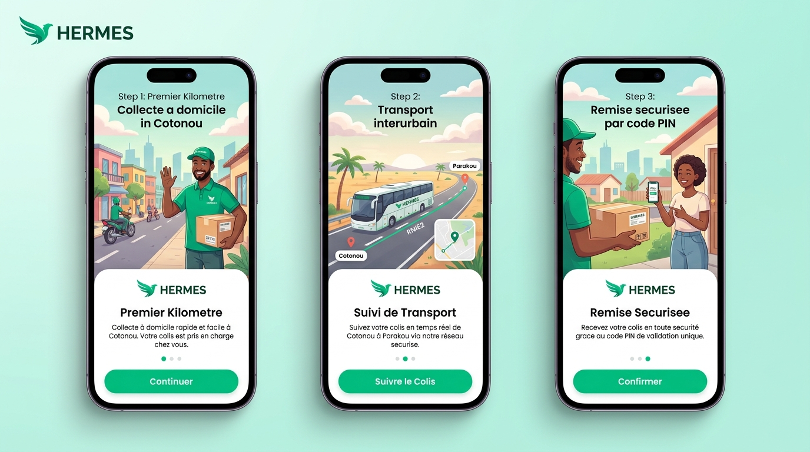

# HERMES by Strategy ARENA — Application Mobile-First MVP

> **Solution de coordination logistique porte-à-porte pour le transport interurbain au Bénin.**  
> **Corridor pilote :** Cotonou ➔ Parakou (RNIE 2 · 420 km)  
> **Version :** 1.0 (Prototype mobile-first interactif)



---

## 1. À propos de HERMES

HERMES est une solution logistique innovante conçue par **Strategy ARENA** pour simplifier l'envoi de colis entre les villes du Bénin sans que l'expéditeur ni le destinataire n'aient à se déplacer en agence ou gare routière.

### L'expérience logistique en 3 temps :
1. **01 · Premier Kilomètre (Collecte) :** Un coursier partenaire Hermes collecte le colis à domicile ou au commerce à Cotonou et le dépose à l'agence d'autocar.
2. **02 · Transport Interurbain (420 km) :** Une compagnie partenaire assure le trajet Cotonou ➔ Parakou en autocar sécurisé via la RNIE 2 avec heure d'arrivée estimée.
3. **03 · Dernier Kilomètre (Livraison) :** Un second coursier Hermes retire le colis à l'agence de Parakou et le livre directement au destinataire contre validation obligatoire d'un **code secret PIN à 6 chiffres**.

> **Principe clé :** HERMES ne remplace pas les compagnies de transport. La plateforme valorise leur réseau et leur apporte des flux pré-enregistrés, étiquetés et tracés.

---

## 2. Démarrage Rapide

### Prérequis
- **Node.js** >= 18.0.0
- **npm** ou **pnpm**

### Installation et Lancement
```bash
# 1. Cloner ou ouvrir le dossier du projet
cd "/Users/shalomtalesman/Projects_/Arena project/Hermes"

# 2. Installer les dépendances
npm install

# 3. Lancer le serveur de développement
npm run dev
```

L'application s'ouvre sur `http://localhost:5174/` (ou `5173`).

### Build de production
```bash
npm run build
```

---

## 3. Scénario de Démonstration (3 à 5 minutes)

Le prototype intègre une expédition de démonstration clé en main : **`HMD-DEMO-001`** (Cotonou ➔ Parakou).

Le présentateur peut dérouler le scénario de deux façons :
- **Mode Guidé Automatique :** Cliquer sur le bouton **« Scénario Démo (X/10) »** dans le bandeau supérieur ou dans le widget flottant en bas à droite. Chaque clic déclenche l'action métier suivante et bascule automatiquement sur l'écran du rôle concerné.
- **Mode Manuel Réaliste :**
  1. **Accueil :** Présenter la proposition de valeur et la chaîne en 3 étapes.
  2. **Espace Client :** Montrer la création d'expédition en 3 étapes ou ouvrir le suivi en direct de `HMD-DEMO-001`.
  3. **Strategy ARENA :** Ouvrir la tour de contrôle, observer les KPI et affecter le coursier de collecte (Koffi Mensah).
  4. **Coursier Hermes :** Ouvrir l'application coursier Cotonou, confirmer la collecte à domicile puis le dépôt en gare.
  5. **Compagnie Partenaire :** Ouvrir le guichet transporteur, valider l'embarquement du car, puis simuler l'arrivée à Parakou.
  6. **Coursier Hermes :** Ouvrir l'application coursier Parakou, retirer le colis et valider la livraison finale contre le code secret.
  7. **Espace Client :** Revenir sur le suivi pour constater la complétion de la chaîne, la timeline horodatée et les feux d'artifice !

Pour recommencer à tout moment : cliquer sur **« Réinitialiser »** dans le bandeau supérieur.

---

## 4. Architecture des 5 Espaces

1. **Accueil Public (`landing`) :** Proposition de valeur, réassurance des transporteurs, parcours 3 étapes, corridor pilote.
2. **Espace Client (`client`) :** Wizard 3 étapes de création, suivi en temps réel avec barre de progression, QR code et code PIN secret.
3. **Coursier Hermes (`courier`) :** Interface mobile-first avec missions de collecte (Cotonou) et de livraison (Parakou), saisie de code et signalement d'anomalies.
4. **Compagnie Partenaire (`carrier`) :** Guichet allégé pour chefs de gare : colis à charger, en transit et arrivés à Parakou.
5. **Strategy ARENA (`arena`) :** Tour de contrôle centrale, 4 KPI, tableau des expéditions, affectations et résolution d'incidents.

---

## 5. Transition vers un MVP avec Backend

Consultez le fichier [`ARCHITECTURE.md`](file:///Users/shalomtalesman/Projects_/Arena%20project/Hermes/ARCHITECTURE.md) pour le plan de migration détaillé vers une architecture API temps-réel (Node.js/Supabase/PostgreSQL + SMS/WhatsApp + Mobile Money).
